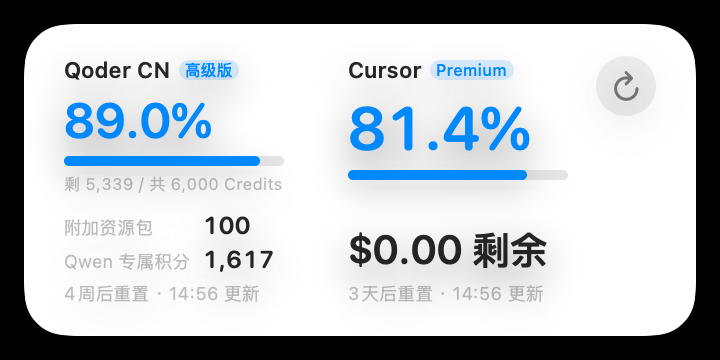
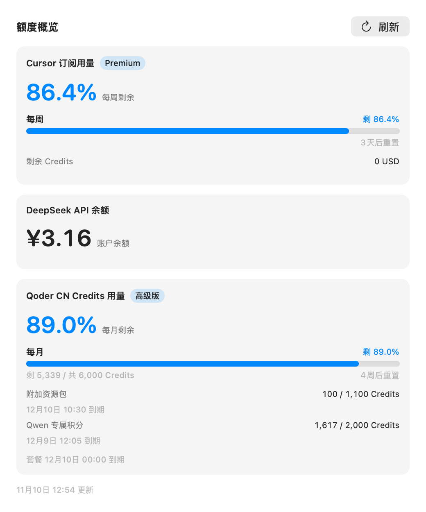

# 大模型额度 · ModelQuotaBar

macOS 桌面小组件：一眼看到大模型套餐还剩多少。

支持：

| 来源 | 看什么 |
|------|--------|
| **通义千问** Token Plan（个人版） | 5 小时 / 每周 / 每月剩余，用量包 Credits |
| **DeepSeek** | 账户余额 |
| **Cursor** | 每周剩余 + Credits |
| **Qoder CN** | 每月 Credits + 附加/专属资源包 |

主应用里配置账号；桌面上放小组件。主应用关掉后，小组件也会自己更新。界面是中文。

## 界面预览

<p align="center">
  
</p>

<p align="center">
  
</p>

## 使用前须知

- 需要 **macOS 14** 或更高。
- 目前只提供**源码**，要自己在电脑上构建一次（约 5～10 分钟）。
- 需要安装 **Xcode**，并用**免费 Apple ID** 登录一次（系统要求：桌面小组件必须签名，否则不会出现在小组件库里）。
- 没有「下载 dmg 双击即用」的安装包（那需要付费苹果开发者账号做公证）。

## 安装

### 1. 下载并打开工程

```bash
git clone https://github.com/skysh3n/ModelQuotaBar.git
cd ModelQuotaBar
open ModelQuotaBar.xcodeproj
```

### 2. 在 Xcode 里登录并选签名

1. `Xcode → Settings… → Accounts` → 用你的 Apple ID 登录（免费即可）。
2. 左侧点工程 → **TARGETS** 里的 `ModelQuotaBar` → **Signing & Capabilities** → **Team** 选你的账号。
3. 对 **`QuotaWidget`** 做同样操作。
4. 菜单 **Product → Run**（或按 ⌘R）运行一次。

### 3. 以后一键安装到「应用程序」（可选）

先在 Xcode 里配好 Team，再在终端执行：

```bash
./scripts/install.sh
```

会构建并安装到 `/Applications/大模型额度.app`。若提示要 Team ID：

```bash
TEAM_ID=你的TeamID ./scripts/install.sh
```

> Team ID 在 [Apple 开发者账户页](https://developer.apple.com/account) 或 Xcode 账号详情里能看到（一串字母数字）。

## 怎么用

### 在应用里添加账号

打开 **大模型额度**，在下方「额度来源」里打开你要用的服务：

1. 点 **「登录获取」**（推荐），在弹出窗口里登录即可。  
2. DeepSeek 没有网页登录：到 [platform.deepseek.com](https://platform.deepseek.com/) 复制 API 密钥，粘贴后点「测试连接」。

| 来源 | 推荐方式 | 注意 |
|------|----------|------|
| 通义千问 | 登录获取 | 选对「中国站 / 国际站」 |
| DeepSeek | 粘贴 API Key | — |
| Cursor | 登录获取 | 尽量用邮箱或 GitHub；Google 登录在内嵌窗口里常被拦 |
| Qoder CN | 登录获取 | 用阿里云账号 |

提示「登录会话已失效」时，再点一次「登录获取」就行。

### 把小组件放到桌面

1. 桌面空白处 **右键 → 编辑小组件**。
2. 搜索 **「大模型额度」**，拖到桌面。
3. **右键小组件 → 编辑**，打开你想看的来源开关。

说明：

- **小尺寸**只显示 1 个来源；**中尺寸**并排最多 **2** 个。
- 要先在主应用里启用并登录成功，小组件里才会真正显示。
- 右上角 **刷新按钮** 可马上更新；平时系统大约十几分钟自动刷新一次。

### 常见问题

**小组件库里找不到？**  
多半是没签名成功。回到 Xcode 给两个 TARGET 都选好 Team，再 Run 或执行 `./scripts/install.sh`。

**小组件是灰色的？**  
删掉桌面上的小组件，再重新添加一次。用 `install.sh` 安装一般更稳。

**数字不更新？**  
点小组件右上角刷新；或打开主应用点「刷新」。若提示会话失效，重新「登录获取」。

**显示的是「剩余」还是「已用」？**  
一律按**还剩多少**显示（例如官网写已用 3%，这里是剩 97%）。

## 限制（简要）

- 千问目前只支持 **Token Plan 个人版**（不含团队版、Coding Plan）。
- 千问 / Cursor / Qoder 用的是各官网控制台接口，对方改版时可能暂时不可用。
- 登录态会过期，过期后在应用里重新登录一次即可。
- 凭据保存在本机应用数据里（仅当前用户可读），不会上传到作者服务器。

## 开发者

```bash
./scripts/test.sh                         # 单元测试
TEAM_ID=xxx ./scripts/build.sh            # 只构建
TEAM_ID=xxx ./scripts/install.sh          # 构建并安装
NO_SIGN=1 ./scripts/build.sh              # 编译检查（小组件无法加载）
./scripts/widget-preview.sh               # 小组件布局预览
```

目录概要：`App/` 主界面，`Widget/` 小组件，`Sources/QuotaCore/` 各厂商与共享逻辑，`Tests/` 测试，`scripts/` 脚本。

接入新厂商：在 `Sources/QuotaCore/Providers/` 实现 `QuotaProvider`，登记到 `ProviderRegistry`，如需出现在小组件再改 `WidgetSource`。设置界面会按凭据字段自动生成。

## 免责声明

仅用于查询**你自己账号**的套餐用量，请勿用于批量抓取或提供给第三方。相关接口由各厂商控制，可能变更。

千问控制台接口细节曾参考（MIT）：[CodexBar](https://github.com/steipete/CodexBar)、[tracking-llm-plan-usage](https://github.com/KS-OTO/tracking-llm-plan-usage)；本项目未引入第三方代码依赖。DeepSeek 使用官方公开余额接口。

## License

MIT，见 [LICENSE](LICENSE)。
