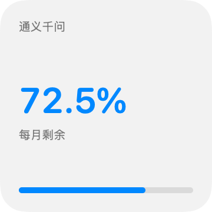
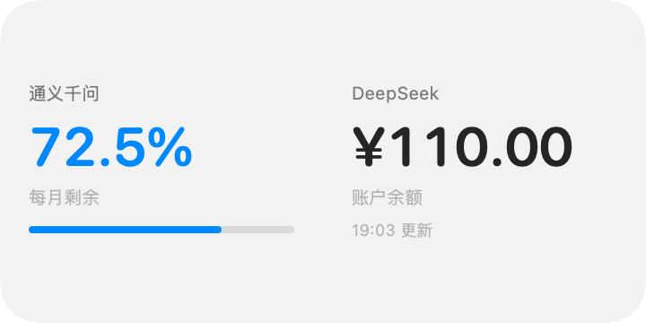
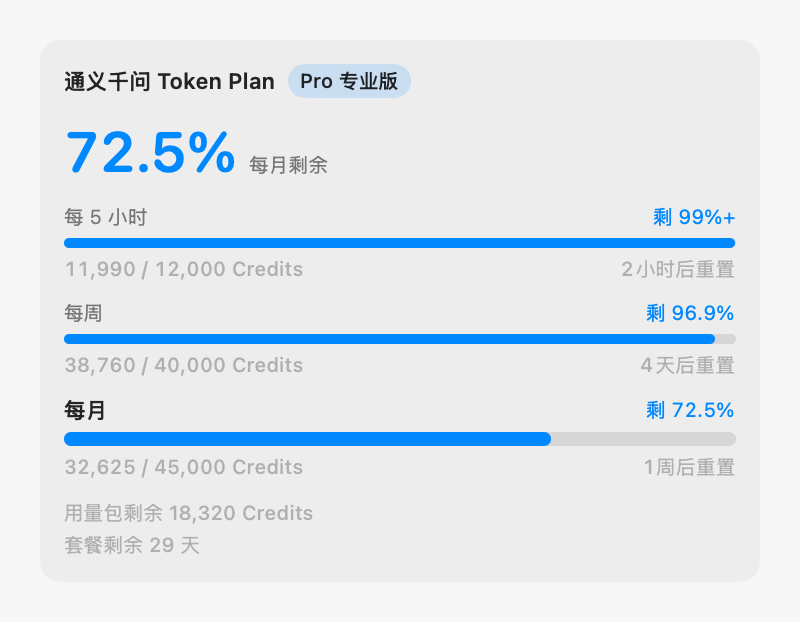

# 大模型额度 · ModelQuotaBar

一个 macOS 桌面小组件，用来盯着你买的大模型套餐和余额还剩多少。

目前适配 **通义千问 Token Plan（个人版）** 与 **DeepSeek 开放平台余额**：千问显示 5 小时 / 每周 / 每月窗口的剩余比例、重置时间和套餐到期天数；DeepSeek 显示账户充值余额。架构按「多厂商」设计，加别家只需新增一个 Provider，界面不用动。

> 界面文案、错误提示都是中文。

## 界面预览

桌面小组件的小、中两种形态（截图为示例数据；小尺寸显示单个来源，中尺寸并排显示多个）：

<p align="center">
  
  
  
</p>

主应用里的额度明细：

<p align="center">
  
</p>

## 功能

- **桌面小组件**：小尺寸显示一个来源，中尺寸并排显示多个。右键小组件 →「编辑」可勾选要显示哪些来源。
- **小组件自己抓数据**：timeline provider 直接请求接口（和天气小组件同一个模式），由系统调度刷新，**不需要主应用运行、也不需要开机自启**。
- **登录获取凭据**：千问的凭据可以在应用内嵌的登录窗口里登一次，自动取到，不用去开发者工具里翻 Cookie。
- **会话保活**：应用在后台定期访问一次控制台，让登录会话按活跃度续期，大幅减少重新登录。
- **多厂商架构**：`QuotaProvider` 协议 + 由 `credentialFields` 自动生成的配置表单，接新厂商不用改 UI。
- **零额外能力依赖**：不需要 App Group、不需要 provisioning profile、不需要登录 Apple 开发者网站，Xcode 里选一次团队就能构建。

## 系统要求

- macOS 14 (Sonoma) 或更高
- 构建需要 Xcode，并在其中登录一个 **Apple ID（免费的就行）** 用于签名
- 本仓库只发源码，面向愿意自己构建的使用者。原因见「已知限制」。

## 构建与安装

```bash
git clone https://github.com/skysh3n/ModelQuotaBar.git
cd ModelQuotaBar
open ModelQuotaBar.xcodeproj
```

在 Xcode 里：

1. 用 Apple ID 登录：`Xcode → Settings… → Accounts → +`。
2. 选中工程 → **TARGETS** 下的 `ModelQuotaBar` → **Signing & Capabilities** → **Team** 选上你的账号。
3. 对 `QuotaWidget` target 做同样的操作。两个 target 能签名即可，**不需要 App Group 之类的额外能力**。
4. ⌘R 运行。

命令行构建：

```bash
TEAM_ID=你的TeamID ./scripts/build.sh
cp -R "dist/大模型额度.app" /Applications/
```

> **iCloud 同步目录的坑。** 仓库若放在「桌面」「文档」这类开了 iCloud 同步的目录里，FileProvider 会给构建产物附加扩展属性，`codesign` 报 `resource fork, Finder information, or similar detritus not allowed`。脚本默认把构建目录放到仓库外（`~/Library/Caches/ModelQuotaBar/`）避开；仍遇到就把仓库移到不同步的目录。

### 为什么必须签名

WidgetKit 扩展只有在带**有效代码签名**时才会被系统加载；未签名或 ad-hoc 签名的扩展会被 `pluginkit` 静默忽略，小组件库里根本搜不到。免费 Apple ID 生成的证书就够自己用。

### 数据怎么从主应用流到小组件

小组件扩展必须带沙盒权限（没有它系统不加载），而沙盒应用只能读自己的容器；主应用则刻意**不开沙盒**，于是可以直接写进小组件的容器目录：

```
~/Library/Containers/com.skysh3n.ModelQuotaBar.widget/Data/Library/Application Support/ModelQuotaBar/
```

里面放两样东西：`credentials.json`（凭据，两个进程都要读）和 `quota-snapshot.json`（额度快照）。这样就不需要 App Group——App Group 是受限权限，用了就必须有 provisioning profile，门槛太高。

> 改 `QuotaWidget` 的 bundle ID 时，要同步改 `Sources/QuotaCore/SharedStore.swift` 里的 `widgetBundleIdentifier`，共享目录是从它推出来的。

## 配置：通义千问 Token Plan

百炼**没有**开放查询套餐用量的 OpenAPI，只能复用控制台自己的接口，因此需要登录态 Cookie。两种方式任选：

**方式一：登录获取（推荐）**

在「额度来源 → 通义千问 Token Plan」里点 **「登录获取」**，在弹出的窗口里登录百炼控制台。登录成功后应用会自动取到凭据并测试连接。之后**后台保活**会定期访问控制台让会话续期，多数情况下不用再管。

**方式二：手动粘贴**

1. 登录 <https://bailian.console.aliyun.com/>。
2. `F12` → **Network** → 刷新页面 → 任选一个发往 `bailian-cs.console.aliyun.com` 的请求。
3. 在 **Request Headers** 里找到 `Cookie`，复制 `login_aliyunid_ticket` 的值（只复制值就行，整段 Cookie 也能用）。
4. 粘贴到对应输入框，站点选「中国大陆站」，点「测试连接」。

会话失效时卡片会提示「登录会话已失效」。此时应用会先尝试用保活会话自动续期；续不上才需要你重新登录。

> **为什么不支持从浏览器读 Cookie**：那需要「完全磁盘访问」（Safari）或钥匙串授权（Chrome）这类额外的系统权限，本项目刻意不引入。内嵌登录窗口用的是应用自己的 WebView，与你平时用哪个浏览器无关。

## 配置：DeepSeek 余额

DeepSeek 有公开的余额接口，配置最简单：

1. 登录 <https://platform.deepseek.com/>。
2. 右上角「API 密钥」里创建或复制一个 `sk-…` Key。
3. 粘贴到「额度来源 → DeepSeek」，点「测试连接」。

## 把小组件放到桌面

桌面空白处**右键 → 编辑小组件** → 搜索「大模型额度」，拖到桌面。加进来之后**右键点它 →「编辑“大模型额度”」**，勾选要显示的来源（可多选）：

- 小尺寸显示勾选里的第一个；
- 中尺寸并排显示全部勾选的来源（勾 1 个时铺满整张卡）。

## 刷新机制

服务端没有推送能力，所以「实时」是靠刷新策略逼近的：

| 场景 | 行为 |
|---|---|
| 小组件（主应用没开） | 由系统调度，约 15 分钟抓一次（系统会按使用频率调整） |
| 主应用运行中 | 额外在切到桌面、系统唤醒、解锁、回到前台时立即刷一次 |
| 会话快过期 | 保活每 6 小时用网页登录态访问一次控制台，让会话续期 |

**不需要开机自启**：小组件自己会抓数据；保活只在应用运行时生效，但它影响的是「会话要不要重登」，不影响小组件出不出数据。

## 关于凭据存储

Cookie / API Key 等价于登录态，直觉上该放钥匙串。但**钥匙串按代码签名识别调用方**，而本项目由使用者各自本地构建、各用自己的证书签名，每次重新编译签名都会变，macOS 会把程序当成另一个应用，于是每次启动都弹一次系统密码框。为避开这个交互，凭据改为存文件（路径见上），权限位收成 `0600`。

这比钥匙串弱一档（同一用户账号下的进程仍可读），对一个只用来看自己套餐余量的工具是划算的折中。

## 已知限制

- **只面向愿意自己构建的使用者**。WidgetKit 扩展必须由 Apple 签发的证书签名才会被系统加载；要把「双击就能用」的 .dmg 发给普通用户，需要付费 Apple Developer Program（$99/年）的 Developer ID 证书并做公证。
- **只支持 Token Plan 个人版**，团队版走另一套 BSS 接口；**不支持 Coding Plan**（按请求次数计费的另一条产品线）。
- **不显示 token 消耗**：官方明确不提供该数据，套餐只按 Credits 抵扣。
- **用量接口是控制台内部接口**，阿里云改动时可能失效；失效时错误提示会尽量说明原因。
- **改小组件类型名或描述符后，桌面上的旧实例会变成空白**，需要删掉重新添加一次（系统会缓存描述符，改 `CFBundleVersion` 可强制重读）。
- **保活依赖应用在运行**，且首次仍需登录一次；彻底不重登做不到——会话有效期由服务端决定。

## 新增一个厂商

1. 在 `Sources/QuotaCore/Providers/` 下新建目录，实现 `QuotaProvider`：

   ```swift
   public enum YourProvider: QuotaProvider {
       public static let metadata = ProviderMetadata(
           id: ProviderID("your-provider"),
           vendor: "厂商名",
           plan: "套餐名",
           summary: "一句话说明查的是什么",
           consoleURL: URL(string: "https://…"))

       public static let credentialFields: [CredentialField] = [
           CredentialField(id: "apiKey", title: "API Key", kind: .secret),
       ]

       public static func fetchSnapshot(credential: ProviderCredential) async throws -> QuotaSnapshot {
           // 用 QuotaWindow 表达时间窗，用 CreditBalance 表达余额
       }
   }
   ```

2. 在 `Sources/QuotaCore/ProviderRegistry.swift` 的 `all` 里加一行 `YourProvider.descriptor`。
3. 如果这个厂商也能用网页登录取凭据，在 `metadata` 上补 `webLogin:` 规格（见 `QwenTokenPlanProvider`），设置界面会自动多出「登录获取」按钮。
4. 若要在小组件里单独列出这个来源，在 `Sources/QuotaCore/WidgetSource.swift` 加一个 `case`。
5. 在 `Tests/QuotaCoreTests/` 补一组解析测试，用真实的响应结构。

界面不用改：设置表单由 `credentialFields` 生成，额度卡片直接渲染 `QuotaSnapshot`。

## 开发

```bash
./scripts/test.sh                      # 编译并运行单元测试
TEAM_ID=你的TeamID ./scripts/build.sh   # 用你的证书签名构建 .app
NO_SIGN=1 ./scripts/build.sh           # 只验证能否编译（产物的小组件不会被系统加载）
swift scripts/make-icon.swift .        # 重新生成应用图标
```

测试不依赖 XCTest，用的是 `Tests/QuotaCoreTests/TestSupport.swift` 里自带的小型执行器。这样做是因为只装 Command Line Tools 的机器上既没有 `XCTest.framework` 也没有 `xcrun xctest`，而本项目希望在任何 Mac 上都能跑测试。

### GitHub Actions

`.github/workflows/ci.yml` 目前**只支持手动触发**（`workflow_dispatch`）。原因是 macOS 运行器的计费系数是 Linux 的 10 倍，私有仓库每月免费额度换算下来只有约 200 分钟。**仓库公开后** Actions 不限分钟，把触发条件改回 `push` / `pull_request` 即可（文件里有注释）。

另外 CI 跑的是 `NO_SIGN=1`，只验证能否编译与产物结构——**CI 通过不代表小组件能被系统加载**，那一步只能在本机用证书验证。

## 项目结构

```
ModelQuotaBar.xcodeproj/      Xcode 工程（两个 target）
App/                          主应用：窗口界面、配置、网页登录取凭据、会话保活
Widget/                       WidgetKit 小组件扩展（只带沙盒权限）
Sources/QuotaCore/            与界面无关的核心：模型、Provider 协议、网关客户端、共享存储
Tests/QuotaCoreTests/         单元测试
scripts/                      构建、测试与图标生成脚本
```

`Sources/QuotaCore` 被两个 target 各自直接编译进自己的模块，而不是做成 framework——小组件扩展依赖 framework 需要在工程里做嵌入，收益不大。

## 免责声明

本项目通过非公开的控制台接口读取**你自己账号**的套餐用量，用途是方便自己看余额。请仅查询自己的数据，不要用于批量抓取或转发给第三方。接口由阿里云控制，可能随时变更。

## License

MIT，见 [LICENSE](LICENSE)。
